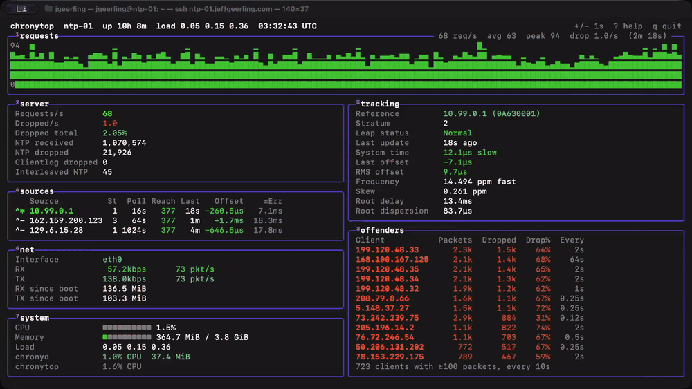

# chronytop

[](https://github.com/geerlingguy/chronytop/actions/workflows/ci.yml)

A TUI for [chrony](https://chrony-project.org) NTP time server monitoring, in the style of [btop](https://github.com/aristocratos/btop).



It graphs NTP requests per second, and shows server counters, the clients chrony is rate limiting the most, sources, tracking, bandwidth, and CPU and memory use (including chronyd's).

Panels resize with the terminal, and can be shown or hidden.

## Requirements

- Linux, with a running chronyd 4.0 or later
- For Unix socket access: root (or `sudo`), or a user with access to the socket; see [Running without root](#running-without-root)
- For UDP access: a reachable chronyd command port and permission for the client's IP address and the requested monitoring commands; local root privileges are not required

chronytop is a single static binary with no dependencies outside the Go standard library, so it runs on any distribution (Debian, Ubuntu, Fedora, RHEL, Arch, Alpine, etc.).

By default, it communicates directly with chronyd over the same Unix command socket normally used by `chronyc` for the server and client panels. Existing installations using that socket need no additional chronyd configuration. Use `-host` for direct UDP monitoring of a local or remote daemon. The `chronyc` executable is no longer required.

The transport is selected explicitly: `-host` uses UDP; otherwise chronytop uses the configured Unix socket. There is no automatic fallback to a different endpoint when the selected one is unavailable.

## Install

Download the binary for your architecture from [Releases](https://github.com/geerlingguy/chronytop/releases), and install it:

```
sudo install --owner=root --group=root --mode=755 chronytop-linux-amd64 /usr/local/bin/chronytop
```

Or build it from source with Go 1.24 or later:

```
CGO_ENABLED=0 go build -trimpath -ldflags "-s -w" -o chronytop .
```

Package maintainers can set the default command socket path at build time to
match their chrony package, without patching the source. For example, for a
chrony build using `--chronyrundir=/run/chrony`:

```
CGO_ENABLED=0 go build -trimpath \
  -ldflags "-s -w -X main.defaultSocket=/run/chrony/chronyd.sock" \
  -o chronytop .
```

This can be combined with `-X main.version=...`. The `-socket` command-line
option always overrides the compiled-in default, and `chronytop -h` shows the
default of the installed binary.

## Usage

```
sudo chronytop
```

| Option | Default | Description |
| --- | --- | --- |
| `-i` | `1s` | Sample interval (500ms to 10s) |
| `-p` | `100` | Minimum packets for a client to be listed in offenders |
| `-socket` | `/var/run/chrony/chronyd.sock` (build configurable) | Absolute path to chronyd's Unix command socket |
| `-host` | | Use UDP: hostname, IPv4/IPv6 address, or `host:port`; port defaults to `323` |
| `-version` | | Print the version and exit |

| Key | Action |
| --- | --- |
| `1`-`7` | Show/hide a panel |
| `+` / `-` | Slower / faster sampling |
| `?` / `h` | Show/hide help |
| `Esc` | Close help, or quit |
| `q` | Quit |

Visible panels and the sample interval are saved when you quit, to `~/.config/chronytop/chronytop.conf` (`/root/.config/...` when run with `sudo`), and restored on the next run. `-i` overrides the saved interval.

The offenders list is refreshed every 10 seconds in the background. chronyd filters clients by `-p` itself, so the list stays cheap to fetch on busy public servers with hundreds of thousands of clients.

Chronyd creates its Unix command socket by default; an explicit `bindcmdaddress`
directive is only needed to change its location or disable it. Chronytop's
upstream default is `/var/run/chrony/chronyd.sock`; on systems where `/var/run`
links to `/run`, this also reaches `/run/chrony/chronyd.sock`. Chronytop does not
parse `chrony.conf` or discover another binary's compiled-in defaults. Use the
package build option above or `-socket` for a different location.

Connections are kept open and re-established on the next refresh after a failure.
Connection and protocol errors appear in the affected panels. Counters not
reported by older chrony versions are omitted from the server panel.

### UDP and remote monitoring

```
chronytop -host 127.0.0.1
chronytop -host ntp.example.net
chronytop -host 192.0.2.10:4323
chronytop -host '[2001:db8::10]:323'
```

The default UDP command port is **323**, separate from NTP's port 123. Set the
port explicitly if the daemon uses a different `cmdport`. `-host` and an explicit
`-socket` cannot be combined. UDP uses an automatically assigned local port and
does not create reply sockets in the filesystem.

For remote access, the server must listen on a reachable address with
`bindcmdaddress`, allow the client's IP with `cmdallow`, and permit UDP traffic
to the command port through its firewall. Tracking and sources are normally
available to allowed clients. Server statistics and clients additionally require
`opencommands` on chrony versions supporting that directive. For example, with
server address `192.0.2.10` and monitoring client `192.0.2.20`:

```
bindcmdaddress 192.0.2.10
cmdallow 192.0.2.20/32
opencommands activity manual rtcdata smoothing sourcename sources sourcestats tracking serverstats clients
```

The `opencommands` list replaces the defaults; this example preserves them and
adds `serverstats` and `clients`. These are server-side settings; chronytop never
changes them. See
[Chrony's command access documentation](https://chrony-project.org/doc/latest/chrony.conf.html#bindcmdaddress).
Rejected commands appear as unavailable, while permitted panels continue to update.

In UDP mode the header identifies the monitored endpoint. Network, CPU, memory,
process usage, host uptime and load are not available through Chrony's command
protocol, so the local system/network panels and header metrics are omitted,
including when `-host` points to localhost. This does not change saved panel
preferences for Unix socket mode.

## Running without root

To run chronytop locally as user `foo`, that user needs access to chronyd's
Unix command socket. Add `foo` to the group under which chronyd runs, if that
group has the required access. The group name depends on the system, for
example `chrony`, `_chrony`, or `ntp`. For the group `chrony`:

```
sudo usermod --append --groups chrony foo
```

Log out and back in for the new group membership to take effect. Depending
on file permissions, this group may also allow changes to `/etc/chrony/`
or other Chrony files. ACLs can grant `foo` the required access without
granting all the group's other permissions.

Either method allows administrative commands through chronyd's socket.
Chronytop itself only sends monitoring commands and manages its own reply
sockets.

## Security

Chronytop:

- Sends only read-only monitoring commands over the selected Unix or UDP socket. It never starts subprocesses, changes daemon settings, or resets counters. Local `/proc` statistics are read only in Unix socket mode. UDP can also perform DNS lookups when a hostname is provided.
- Writes its settings file only if you changed a setting. It skips the file and its directories unless they're owned by the user running chronytop (so a non-root `HOME` under `sudo` is ignored), and saves through a temporary file, so it never follows a symlink.
- Keeps reply sockets in private directories beside chronyd's socket for the lifetime of each connection, removing them on failure or normal shutdown. Permission changes and socket removal are anchored to a verified directory descriptor. Reply sockets allow chronyd's user to send responses; the connected socket accepts datagrams only from the selected daemon socket.
- Strips non-printable characters from everything it displays, so data from chrony can't inject terminal escape sequences.

CI runs `go vet`, `staticcheck`, `gosec`, and `govulncheck` on every change.

## Testing

Run `go test -race ./...` on Linux. The protocol tests use fake Unix and UDP daemons and require neither root nor an installed chronyd. To additionally query a running daemon without changing its configuration or counters:

```
sudo env CHRONYTOP_TEST_SOCKET=/run/chrony/chronyd.sock go test -run TestSocketLive -v
CHRONYTOP_TEST_UDP=127.0.0.1:323 go test -run TestUDPLive -v
```

## License

MIT
